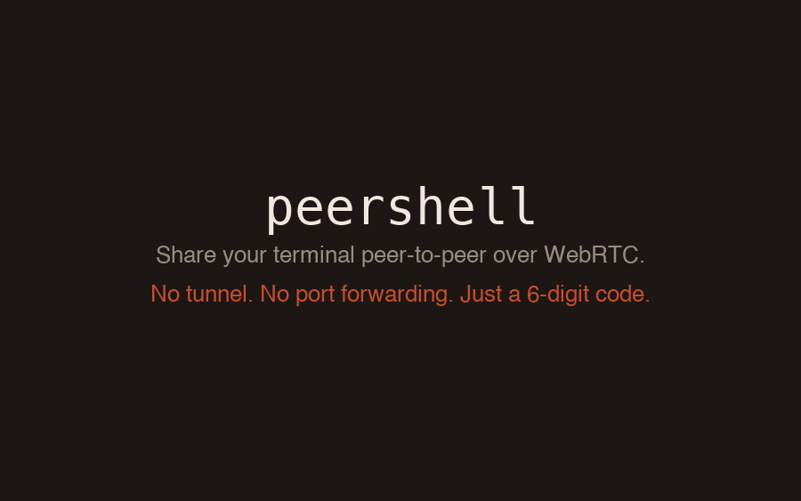

# peershell

Run a CLI agent on your machine, get a 6-digit code, share your terminal into someone else's browser over peer-to-peer WebRTC. The signaling server only sees the handshake — your terminal bytes flow directly between the two peers (DTLS-encrypted by WebRTC).

**Live:** https://peershell.vercel.app · **Source:** https://github.com/mealisohail/peershell

Install the agent (needs Go 1.22+):

```bash
curl -fsSL https://peershell.vercel.app/install.sh | sh
```



## Layout

```
agent/       Go CLI agent (pion/webrtc + creack/pty)
signaling/   Node.js WebSocket signaling server (TypeScript)
web/         Browser client (Vite + xterm.js)
docs/        Protocol, security model, manual test checklist
```

## Requirements

- Go 1.22+
- Node.js 20+ (Node 18 also works locally with a `EBADENGINE` warning)
- Linux or macOS (Windows out of scope for v1)

## Install

```bash
# signaling
cd signaling && npm install && cd ..

# web
cd web && npm install && cd ..

# agent
cd agent && go mod download && cd ..
```

## Run it locally (everything on one machine)

Open three terminals.

```bash
# Terminal 1 — signaling server (port 8080 by default)
cd signaling
PORT=9876 npm start          # or `npm run dev` for hot-reload
```

```bash
# Terminal 2 — agent (gets a 6-digit code and waits for a viewer)
cd agent
PEERSHELL_SERVER=ws://localhost:9876/ws SHELL=/bin/bash go run ./cmd/peershell
```

```bash
# Terminal 3 — browser client (Vite dev server, port 5173 by default)
cd web
VITE_SIGNALING_URL=ws://localhost:9876/ws npm run dev -- --port 5189
```

Open `http://localhost:5189`, type the 6-digit code printed by the agent, hit Connect. You should land in a full-screen terminal.

> If you don't override the ports, signaling listens on `8080` and the web client on `5173`. Override only if those are taken on your machine.

### Agent flags

| Flag       | Env                | Default                          |
| ---------- | ------------------ | -------------------------------- |
| `--server` | `PEERSHELL_SERVER` | `ws://localhost:8080/ws`         |
| `--shell`  | `SHELL`            | `/bin/bash`                      |
| `--stun`   | `PEERSHELL_STUN`   | `stun:stun.l.google.com:19302`   |

Plus `--pty-test`: spawns a shell behind a PTY, runs `ls`, prints the output, exits. Useful for verifying PTY works on a new host.

### Signaling server env

| Env                     | Default        |
| ----------------------- | -------------- |
| `PORT`                  | `8080`         |
| `RATE_LIMIT_PER_MINUTE` | `5`            |
| `CODE_TTL_SECONDS`      | `600`          |
| `LOG_LEVEL`             | `info`         |

### Web client env

| Env                  | Default                          |
| -------------------- | -------------------------------- |
| `VITE_SIGNALING_URL` | `ws://localhost:8080/ws`         |
| `VITE_STUN_URL`      | `stun:stun.l.google.com:19302`   |

## Sharing your terminal with someone else

You run the agent. They open the web client in their browser. The signaling server has to be reachable from both of you; the WebRTC peer connection then goes direct.

### Option A — same network (LAN / WiFi)

Easiest. The signaling server already binds to all interfaces by default; the only thing you have to change is telling Vite to expose the dev server to the LAN.

First, find your LAN IP — `ipconfig getifaddr en0` on macOS, `hostname -I | awk '{print $1}'` on Linux. Below I'll call it `<LAN_IP>`.

```bash
# Terminal 1 — signaling
cd signaling
PORT=9876 npm start

# Terminal 2 — agent points at localhost (you're on the same box)
cd agent
PEERSHELL_SERVER=ws://localhost:9876/ws SHELL=/bin/bash go run ./cmd/peershell

# Terminal 3 — web client, bound to all interfaces, pointing at the LAN IP
# (browsers on other machines can't resolve "localhost" to your box)
cd web
VITE_SIGNALING_URL=ws://<LAN_IP>:9876/ws npm run dev -- --host 0.0.0.0 --port 5189
```

Tell the other person to open `http://<LAN_IP>:5189` in their browser and type the 6-digit code your agent prints.

### Option B — across the internet (Cloudflare Tunnel, free)

The cheapest "expose to anyone on the internet" path. You need [`cloudflared`](https://developers.cloudflare.com/cloudflare-one/connections/connect-networks/downloads/) installed (`brew install cloudflared` on macOS).

```bash
# Terminal 1 — signaling on localhost
cd signaling && PORT=9876 npm start

# Terminal 2 — agent
cd agent && PEERSHELL_SERVER=ws://localhost:9876/ws SHELL=/bin/bash go run ./cmd/peershell

# Terminal 3 — web dev server on localhost
cd web && VITE_SIGNALING_URL=wss://<your-signaling-tunnel-host>/ws npm run dev -- --port 5189

# Terminal 4 — tunnel signaling
cloudflared tunnel --url http://localhost:9876
# Cloudflared prints something like:
#   https://abc-def-ghi.trycloudflare.com
# Use that hostname as the signaling URL: wss://abc-def-ghi.trycloudflare.com/ws

# Terminal 5 — tunnel web
cloudflared tunnel --url http://localhost:5189
# Cloudflared prints another URL like:
#   https://xyz-uvw.trycloudflare.com
# Share that URL with the person — they open it in a browser.
```

Two important details:
- Use `wss://` (not `ws://`) for the signaling URL because cloudflared terminates TLS.
- You need to know the signaling tunnel URL before starting Vite, so spin up cloudflared for signaling first, then restart Vite with the right `VITE_SIGNALING_URL`.

Other tunnels work too — `ngrok http 9876` / `ngrok http 5189`, `tailscale serve`, `bore`, `localtunnel`, etc.

### Option C — proper deploy

For non-throwaway use, deploy the signaling server somewhere persistent (Fly.io, Railway, Render, a small VPS) and host the static `web/` build on any CDN. The agent talks `wss://your-host/ws`; viewers visit your hosted web client.

```bash
# Build the web client
cd web && npm run build
# Deploy dist/ to your static host of choice.
```

The signaling server has a Dockerfile (`signaling/Dockerfile`); `docker build -t peershell-signaling signaling/ && docker run -p 8080:8080 peershell-signaling`.

### Security caveats when exposing publicly

- The only thing standing between an attacker and a shell on your machine is the **6-digit pairing code** (1,000,000 combinations). Brute force is rate-limited (5 attempts/minute/IP, IP lock after 3 wrong tries), but the bound is statistical, not absolute.
- Codes are **single-use**: once a viewer pairs, the agent generates a fresh code on the next session.
- Codes **expire** after 10 minutes of inactivity.
- The agent gives the connected viewer your **shell**, with your user's permissions. Don't share with people you wouldn't hand your unlocked laptop to.
- Don't expose the agent itself — only the **signaling server** and **web client** are network-facing. The agent only makes outbound WS connections.

## Run the tests

```bash
# Signaling unit tests
cd signaling && npm test

# Signaling manual integration test (spins up server, runs through full protocol)
cd signaling && npm run test:manual

# Agent: all unit + integration tests (the integration test launches the
# real signaling server via npm start, so npm must be on PATH)
cd agent && go test ./... -timeout 120s

# Web client unit tests
cd web && npm test
```

## Docker compose (signaling only)

```bash
docker compose up signaling
```

The agent **cannot** run in Docker easily — it needs a real host PTY and to spawn your login shell.

## Status

Through Phase 7 of the build plan. End-to-end terminal sharing works: agent ↔ signaling ↔ browser, with xterm.js wired to a real PTY.

See [PRD.md](PRD.md) for the full spec if it's present, or the original spec for build plan and acceptance criteria.
